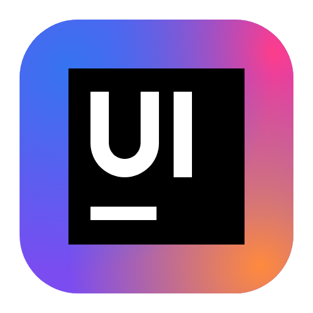

# IntelliJ New UI Themes for Orca

The look of IntelliJ IDEA's New UI, ported to [Orca](https://github.com/stablyai/orca):

| Kind | What you get |
| --- | --- |
| App themes | IntelliJ New UI Dark, New UI Light, Islands Dark, Islands Light — window chrome, sidebars, tabs, chat, diffs and Git colors |
| Code highlighting | The IntelliJ editor schemes (keywords `#CF8E6D`, strings `#6AAB73`, functions `#56A8F5` in Dark; the classic blue/green/purple in Light), built into each app theme |
| Terminal themes | IntelliJ's console ANSI palettes, one per variant |
| File icons | IntelliJ New UI file-type and folder icons, in a Dark and a Light set |
| Symbols file icons | A second, minimal icon set: [Symbols](https://github.com/miguelsolorio/vscode-symbols) by Miguel Solorio, colored glyphs without file outlines; works on light and dark |
| Font | JetBrains Mono (Regular, Italic, Bold, Bold Italic) |

Every color is read from IntelliJ Community's own theme and color scheme files, not eyeballed.
Orca can recolor its interface but not change its layout, so the Islands variants bring
Islands' colors (dark islands in a lighter frame, blue tab pills), not its rounded floating panels.

## Install

```sh
orca plugin install xiaocLoveMoney/idea-new-ui-themes
```

Or Settings → Plugins → install from Git with the repository URL. The plugin is content only
(`execution: data`): it runs no code and asks for no access.

Then pick, in Settings → Appearance:

- **Theme**: IntelliJ New UI Dark / Light, or IntelliJ Islands Dark / Light
- **Terminal theme**: the matching IntelliJ entry
- **File icons**: IntelliJ New UI Icons (Dark) or (Light), or Symbols
- **Editor / terminal font**: JetBrains Mono

Requires Orca 1.4.253 or newer.

## Icon coverage

Only icons that are open source in IntelliJ Community are included: Java, Kotlin, Groovy,
Gradle, Scala, Python, Jupyter, JavaScript, TypeScript, Vue, HTML, CSS, JSON, XML, YAML, TOML,
Markdown, shell, SQL, GraphQL, C/C++, C#, Swift, PHP, Perl, Terraform, Docker, images, fonts,
archives and more, plus source/test/resources/excluded folder icons. File types whose IntelliJ
icon ships only in commercial IDEs (Go, Rust, Ruby…) show the generic file icon. The full map is
`src/icon-mapping.json`.

## Symbols coverage

Orca allows 512 name mappings per icon theme and Symbols has over 1,400, so the import keeps the
most common folders, file names and extensions (priority lists in `tools/import-symbols.ts`) and
fills the rest of the budget in Symbols' own order. Icons Orca cannot draw (over 64 KB, or with
embedded images) are skipped. To refresh from upstream:

```sh
git clone --depth 1 https://github.com/miguelsolorio/vscode-symbols.git /tmp/vscode-symbols
node tools/import-symbols.ts /tmp/vscode-symbols
node tools/tighten-icons.ts icons/symbols   # crop padding so icons fill the slot; needs Chrome
npm run build
```

## Develop

The plugin icon is drawn by hand in `assets/icon.svg`, in the style of JetBrains product icons but with its own "UI" code and colors (it is not the IntelliJ IDEA logo); `assets/icon.png` is its 512×512 render.

The theme files under `themes/`, `terminal/` and `icons/*.json` are generated; edit `src/` instead.

```sh
npm run build    # src/ -> themes/, terminal/, icons/*.json (Node 22.18+, no dependencies)
npm test         # unit tests, and checks the generated files are up to date
orca plugin validate .
orca plugin dev watch .
```

The build refuses a palette that Orca would not paint as written: unknown tokens, non-hex
values, themes over 16 KiB, and any surface/text pair that fails the contrast check Orca runs
before applying a theme (`tools/contrast.ts` ports it). Orca drops such tokens silently, so this
is the only place you would hear about it.

Where IntelliJ's exact color fails that check, the nearest IntelliJ palette step is used instead,
for example primary buttons use `#366ACE` instead of `#3574F0` so white text stays at 4.5:1.

## License

MIT for this repository's own files. The icons and colors come from IntelliJ Community
(Apache-2.0), the Symbols icons from vscode-symbols (MIT) and the fonts from JetBrains Mono (OFL-1.1); see [NOTICE](NOTICE) and `licenses/`.
Unofficial: not affiliated with or endorsed by JetBrains.
